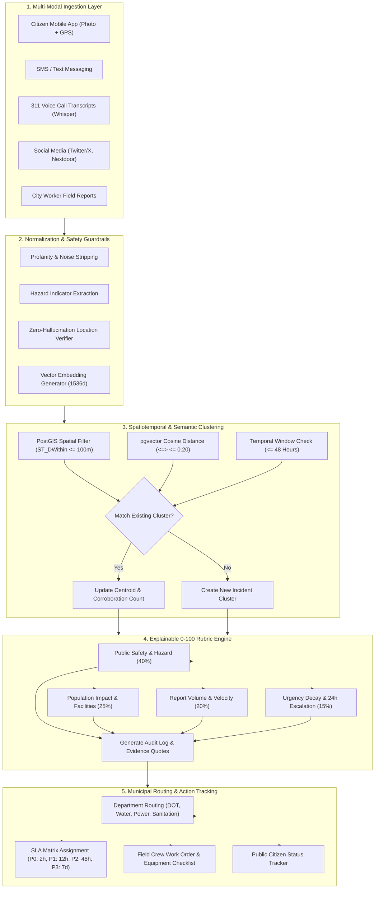

# CivicPulse: AI-Powered Civic Issue Triage & Action-Tracking Platform

[](https://opensource.org/licenses/Apache-2.0)
[](https://python.org)
[](https://fastapi.tiangolo.com)
[](https://www.postgresql.org/)
[](https://postgis.net/)
[](https://github.com/pgvector/pgvector)

**CivicPulse** is an enterprise-grade civic technology platform that ingests unstructured, multi-channel citizen reports (mobile app submissions, SMS, voice call transcripts, social media posts, and legacy 311 logs) and transforms them into deduplicated, prioritized, explainable, and trackable work orders for municipal departments.

---

## 1. System Architecture & End-to-End Data Flow



---

## 2. Core Pillars & Capabilities

### Pillar 1: Multi-Modal Ingestion & Normalization
- Extracts core entities: verified location geofence, infrastructure category, affected assets, and media attachments.
- **Zero Hallucination on Locations:** Only coordinates or landmarks explicitly stated in the input or GPS metadata are used. Ambiguous locations (e.g., *"around here somewhere"*) are flagged as `Low` confidence for human dispatcher geocoding.
- **Objective De-Escalation:** Strips profanity and emotional vitriol while strictly preserving critical safety keywords (*"sparks flying"*, *"water rising"*, *"elderly trapped"*, *"traffic lights dead"*).

### Pillar 2: Semantic Deduplication & Clustering
- Solves the classic municipal 311 problem where 20 citizens report the same fallen branch or water main burst with differing descriptions.
- Employs a dual-condition match:
  1. **Geospatial Proximity:** Distance $\le 100\text{ meters}$ using PostGIS `ST_DWithin(geom, centroid, 100.0)`.
  2. **Semantic Similarity:** Cosine similarity $\ge 0.80$ using `pgvector` HNSW index on report embeddings.
  3. **Temporal Horizon:** Incidents within 48 hours merge; reports after 48 hours constitute recurring failures.
- Automatically recalculates weighted GPS centroids and increments corroboration scores without generating duplicate work tickets.

### Pillar 3: Explainable Prioritization Rubric (0–100 Scale)
Every incident receives a transparent score with an immutable audit log:
$$\text{Total Score} = S_{\text{safety}} (0-40) + I_{\text{impact}} (0-25) + C_{\text{corroboration}} (0-20) + U_{\text{decay}} (0-15)$$

- **P0_Critical (80–100):** Immediate threat to life/limb, active high-voltage hazards, major water main breaches. SLA: 2 Hours.
- **P1_High (60–79):** Severe infrastructure damage, major transit arterial blocked, school/hospital proximity. SLA: 12 Hours.
- **P2_Medium (35–59):** Non-life-threatening physical hazards, localized potholes, single lane obstructions. SLA: 48 Hours.
- **P3_Low (0–34):** Cosmetic issues, minor graffiti, routine park maintenance, non-overflowing litter. SLA: 7 Days.

### Pillar 4: Automated Routing & Citizen Transparency
- Directs tickets to responsible municipal authorities (Transportation, Water Management, Power & Utilities, Public Safety, Sanitation, Parks).
- Generates field equipment checklists (e.g. *High-Voltage Bucket Truck*, *Submersible Pumps*, *Traffic Attenuator*).
- Provides an empathetic, public-facing status message and bi-directional tracker:
  `Received` $\rightarrow$ `Triaged` $\rightarrow$ `Dispatched` $\rightarrow$ `In Progress` $\rightarrow$ `Resolved`.

---

## 3. Database Schema (PostgreSQL + PostGIS + pgvector)

The platform includes a production-grade DDL in [`schema.sql`](file:///c:/Users/SATISH/OneDrive/Desktop/H2S/schema.sql):
- **`raw_reports`**: High-throughput multi-channel ingestion table with PostGIS `GEOGRAPHY(Point, 4326)` and pgvector `vector(1536)`.
- **`incident_clusters`**: Aggregated physical incidents with dynamic centroids, priority breakdowns, and tracking statuses.
- **`priority_audit_logs`**: Immutable audit ledger recording score recalculations, model weights, and evidence citations.
- **`work_orders`**: Municipal dispatch orders with SLA countdowns and equipment requirements.
- **`status_updates`**: Citizen-facing timeline with photo-verified resolution proofs.

---

## 4. Output Schema (Strict JSON)

The AI engine produces JSON strictly conforming to the requested municipal specification:

```json
{
  "cluster_id": "c7f918e2-45a8-4c19-9137-b6151772f91a",
  "normalized_title": "Downed high-voltage power line sparking near school",
  "category": "Electrical_Grid",
  "assigned_department": "Municipal Power & Utilities Authority",
  "location": {
    "address_or_landmark": "Lincoln Elementary School, 400 Elm St",
    "coordinates": {
      "lat": 37.77494,
      "lng": -122.41941
    },
    "location_confidence": "High"
  },
  "priority": {
    "tier": "P0_Critical",
    "total_score": 96.0,
    "score_breakdown": {
      "safety_score": 40.0,
      "impact_score": 23.0,
      "corroboration_score": 18.0,
      "urgency_decay_score": 15.0
    },
    "explainable_rationale": "Assigned priority P0_Critical with an aggregate score of 96.0/100. Public safety contributed 40.0/40 based on detected hazard indicators ('sparks flying'), amplified by 23.0/25 population/facility impact due to proximity to Lincoln Elementary School and 18.0/20 multi-channel corroboration.",
    "key_evidence_quotes": [
      "sparks flying everywhere right next to Lincoln Elementary School crosswalk",
      "Downed live wire sparking on Elm St near Lincoln Elementary",
      "Live electrical cable hanging low across sidewalk in front of elementary school, arcing and smoking on wet pavement"
    ]
  },
  "action_plan": {
    "recommended_first_response": "Deploy high-voltage utility crew to de-energize damaged feeder, establish a 50-foot safety exclusion perimeter, and isolate downed line.",
    "required_equipment_or_crew": [
      "High-Voltage Bucket Truck",
      "Arc-Flash Safety PPE",
      "Line Voltage Tester",
      "Traffic Barrier Cones"
    ],
    "target_sla_hours": 2.0
  },
  "citizen_status_message": "URGENT DISPATCH: Our municipal utility emergency crew has been dispatched to isolate and repair the electrical hazard. Field personnel are establishing safety perimeters. Please keep a safe distance of at least 50 feet."
}
```

---

## 5. Quick Start & Execution

### Installation
```bash
git clone https://github.com/your-org/civicpulse.git
cd civicpulse
python -m venv venv
source venv/bin/activate  # On Windows: .\venv\Scripts\activate
pip install -r requirements.txt
```

### Running the Standalone Pipeline Demo
Execute the zero-dependency end-to-end demonstration script:
```bash
python demo.py
```

### Launching the FastAPI Service
```bash
uvicorn app.main:app --host 0.0.0.0 --port 8000 --reload
```
Interactive OpenAPI documentation will be accessible at: `http://localhost:8000/docs`.

### Running Automated Test Suite
```bash
python app/tests/test_triage.py
```
Validates:
1. P0 critical emergency hazard scoring.
2. 3-channel noisy deduplication into a single cluster.
3. Zero-hallucination validation on ambiguous locations.
4. P3 low-priority cosmetic issue handling.

